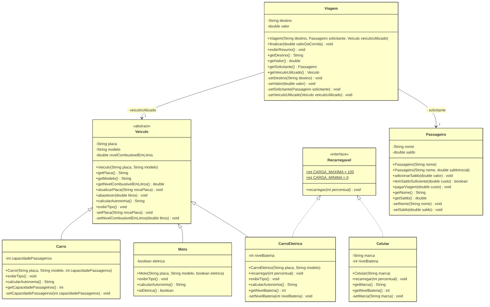
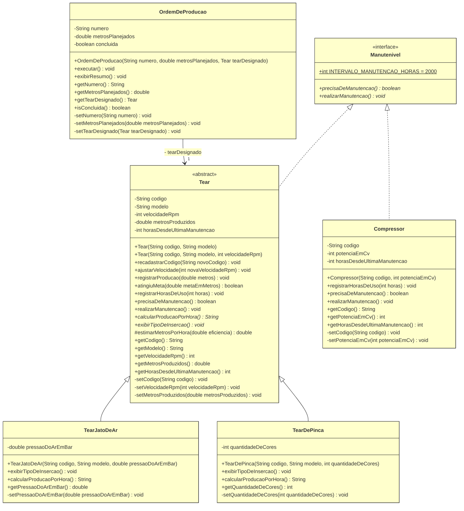

# Projeto FiapRide - Daniel Silva de Castro

## 📊 Informações do Aluno

- **Nome:** Daniel Silva de Castro
- **RM:** 567894
- **Turma:** 2CCPS
- **Curso:** Ciência da Computação
- **GitHub:** [@daniels-decastro](https://github.com/daniels-decastro)

---

## 🎯 Descrição do Projeto

Este projeto é o resultado do aprendizado nas aulas 1-9 de Programação Orientada a Objetos, onde desenvolvemos o sistema **FiapRide**, um aplicativo de mobilidade urbana com passageiros, veículos (carro, moto e carro elétrico) e viagens.

Também fiz um projeto pessoal: um **sistema para controlar os teares de uma tecelagem**. Escolhi esse tema porque tenho mais de dez anos de experiência na indústria têxtil.

Cada aula tem o seu commit, então dá para ver no histórico como o código foi mudando, da primeira classe até as interfaces.

### Estrutura

```
src/br/com/fiapride/
├── model/      FiapRide: Passageiro, Veiculo, Carro, Moto, CarroEletrico, Viagem, Recarregavel, Celular
├── pessoal/    Projeto pessoal: Tear, TearJatoDeAr, TearDePinca, OrdemDeProducao, Manutenivel, Compressor
└── main/       SistemaPrincipal (testes do FiapRide) e TesteMeuObjeto (testes do projeto pessoal)
diagramas/      Diagramas de classe em PNG
```

### Como executar

Na raiz do repositório (Java 11 ou superior):

```bash
javac -encoding UTF-8 -d bin $(find src -name "*.java")
java -cp bin br.com.fiapride.main.SistemaPrincipal
java -cp bin br.com.fiapride.main.TesteMeuObjeto
```

Cada `main` tem um método `demonstrar...()` para cada assunto. Os testes também usam valores errados de propósito, para mostrar as validações funcionando.

---

## ✅ Checklist de Implementação

- [x] Aula 1 - Classes e Objetos
- [x] Aula 2 - Métodos
- [x] Aula 3 - Encapsulamento
- [x] Aula 4 - Construtores
- [x] Aula 5 - Associação
- [x] Aula 6 - Herança
- [x] Aula 7 - Polimorfismo
- [x] Aula 8 - Classes Abstratas
- [x] Aula 9 - Interfaces

### O que cada aula acrescentou

| Aula | FiapRide | Projeto pessoal (tecelagem) |
|---|---|---|
| 1 | `Passageiro` com atributos e tipos | `Tear` com código, modelo, velocidade e produção |
| 2 | `adicionarSaldo`, `pagarViagem` e `temSaldoSuficiente` (com retorno) | `ajustarVelocidade`, `registrarProducao` e `atingiuMeta` (com retorno) |
| 3 | Atributos `private`, getters públicos e `setSaldo` privado | Atributos `private`, setters privados com validação |
| 4 | Construtores com `this()` e classe `Veiculo` sem `setModelo` | Construtor padrão e customizados com `this()`, `recadastrarCodigo()` |
| 5 | `Viagem` TEM UM `Passageiro` e TEM UM `Veiculo` | `OrdemDeProducao` TEM UM `Tear` |
| 6 | `Carro` e `Moto` herdam de `Veiculo` | `TearJatoDeAr` e `TearDePinca` herdam de `Tear` |
| 7 | `calcularAutonomia()` sobrescrito e `List<Veiculo>` | `calcularProducaoPorHora()` sobrescrito e `List<Tear>` |
| 8 | `Veiculo` abstrata com `exibirTipo()` | `Tear` abstrata com `exibirTipoDeInsercao()` e `calcularProducaoPorHora()` |
| 9 | Interface `Recarregavel`, `CarroEletrico` e `Celular` | Interface `Manutenivel`, implementada por `Tear` e `Compressor` |

### Diagramas de classe

Notação UML: `-` privado, `+` público, `#` protegido, *itálico* abstrato e <u>sublinhado</u> estático (constante).

**FiapRide**



**Projeto pessoal: controle de teares**



---

## 🤔 Perguntas de Reflexão

### Aula 1 - Classes e Objetos

**Pergunta:** Por que precisamos criar uma classe `Passageiro`? Não seria mais fácil apenas criar variáveis soltas no main, como `String nomeAna = "Ana"` e `double saldoAna = 50.0`?

**Pense:** E se o FiapRide tiver 1 milhão de usuários? Como a Classe ajuda a resolver isso?

**Sua Resposta:**
Com variáveis soltas, cada passageiro novo precisa de duas variáveis novas (`nomeAna`, `saldoAna`, `nomeCarlos`...). Com 1 milhão de usuários, seriam 2 milhões de variáveis escritas à mão. Isso é impossível de manter, e não dá para percorrer todos os passageiros em um laço.

A classe resolve isso. Eu escrevo a estrutura uma vez só (nome e saldo) e crio quantos passageiros quiser com `new Passageiro(...)`. Cada objeto guarda os seus próprios valores. É na classe também que ficam as regras e a proteção dos dados, que vimos nas aulas seguintes.

No meu projeto pessoal é igual. A fábrica tem vários teares com os mesmos dados (código, modelo, velocidade e produção), só que com valores diferentes. Também deixei de fora o que o controle de produção não usa, como a cor da máquina.

---

### Aula 2 - Métodos

**Pergunta:** Se nós podemos simplesmente fazer `passageiro.saldo = passageiro.saldo + 100` diretamente no código principal, por que dá tanto trabalho criar um método específico chamado `adicionarSaldo(valor)` para fazer isso? Quais seriam os riscos para a nossa startup de mobilidade se deixássemos qualquer programador alterar o saldo diretamente?

**Sua Resposta:**
Porque o método deixa a regra em um lugar só. Dentro de `adicionarSaldo()` eu verifico se o valor é maior que zero. Se qualquer um pudesse mexer no saldo direto, cada programador teria que lembrar dessa verificação, e um único esquecimento já deixaria passar algo como `saldo = saldo + (-500)`.

Para a empresa, os riscos seriam saldo negativo, crédito aparecendo do nada e corrida cobrada de quem não tinha dinheiro. E ninguém saberia em que parte do código o erro aconteceu.

No meu código, `pagarViagem()` usa `temSaldoSuficiente()` antes de descontar. No tear, `ajustarVelocidade()` não deixa a máquina passar de 1200 rpm, e `registrarProducao()` não aceita produção negativa.

---

### Aula 3 - Encapsulamento

**Pergunta:** No nosso código, os atributos são `private`, mas os métodos `getSaldo()` e `getNome()` são `public`. Por que é seguro deixar o `get` público, mas perigoso deixar o atributo original público?

Pense bem: Qual a diferença entre dar a alguém uma CÓPIA de um documento seu, e entregar o documento ORIGINAL para a pessoa rasurar?

**Sua Resposta:**
O getter entrega só uma cópia do valor. Quem chama `getSaldo()` consegue ler o saldo, mas não consegue mudar o saldo de verdade. Já o atributo público é o documento original, que qualquer parte do código pode alterar sem passar por nenhuma regra.

Com o atributo `private`, o saldo só muda pelos métodos que validam, que são `adicionarSaldo()` e `pagarViagem()`. Também deixei o `setSaldo()` privado, porque dinheiro não deve ser editado, só recarregado ou gasto.

No tear fiz o mesmo com a produção. Ela só aumenta por `registrarProducao()`, como o contador de uma máquina de verdade. Se alguém escrever `tear1.metrosProduzidos = -50.0;`, o código nem compila.

---

### Aula 4 - Construtores

**Pergunta:** Na nossa classe `Veiculo`, nós tomamos duas decisões arquitetônicas muito importantes:

1. Nós **não** criamos o método `setModelo()`.
2. O `setPlaca()` foi criado como **privado**, e criamos um método público chamado `atualizarPlaca()` para acessá-lo.

Pensando no mundo real e no Clean Code: Por que é um erro gravíssimo clicar em 'Gerar Getters e Setters para tudo' automaticamente na sua IDE? Como as nossas duas decisões acima protegem o sistema de fraudes e falhas de lógica?

_Dica: Pense sobre o que pode ou não mudar fisicamente em um carro, e a diferença entre "alterar um dado no banco" e "executar um processo real no Detran"_

**Sua Resposta:**
Porque nem todo dado pode mudar. Se a IDE gerar um `setModelo()`, alguém consegue transformar um Corolla em Fusca com uma linha de código. Isso não acontece no mundo real, então o modelo entra pelo construtor e não tem setter.

A placa pode mudar, mas só por um processo oficial no Detran. Por isso o `setPlaca()` é privado e o caminho público é `atualizarPlaca()`. Assim ninguém troca a placa sem passar pelo processo, o que evita fraudes como esconder um carro multado com outra placa. Mudar um dado no banco é diferente de fazer um processo real.

No meu projeto usei a mesma ideia. O modelo do tear não muda, e o código de patrimônio só muda por `recadastrarCodigo()`. Nessa aula também criei construtores que chamam outros construtores com `this()`, para que todo tear já nasça com dados válidos.

---

### Aula 5 - Associação

**Pergunta:** "No construtor da `Viagem`, nós exigimos o objeto inteiro (`Passageiro solicitante`). Se o nosso resumo só precisa imprimir o nome da pessoa, não seria mais fácil e mais leve pedir apenas a String do nome no construtor da Viagem (`String nomeDoPassageiro`) em vez do objeto todo?"

_Pense nas regras de negócio: O que acontece na hora que a Viagem acaba e o sistema precisa descontar o saldo? Se a Viagem tiver apenas a String "Ana Silva", ela consegue mexer no dinheiro dela?_

**Sua Resposta:**
Não. A viagem não serve só para imprimir o nome. No fim da corrida ela precisa cobrar o passageiro, e com a String "Ana Silva" ela não consegue, porque um texto não tem saldo nem métodos.

Guardando o objeto `Passageiro`, a viagem pode chamar `temSaldoSuficiente()` e `pagarViagem()`. Foi o que fiz no método `finalizar()`. Também não fica mais pesado, porque a viagem guarda só uma referência para o objeto, e não uma cópia dele.

Testei isso no main. A Ana recarregou depois de a viagem ser criada, e a viagem já mostrou o saldo novo. No meu projeto, a `OrdemDeProducao` guarda o objeto `Tear` pelo mesmo motivo, para registrar a produção direto na máquina.

---

### Aula 6 - Herança

**Pergunta:** "No nosso código, a mãe `Veiculo` possui os atributos `placa` e `modelo` como `private`. Quando o `Carro` herda de `Veiculo`, ele recebe esses atributos, mas o código dentro de `Carro` NÃO consegue fazer `this.placa = "ABC"`. Ele é obrigado a usar o `super()` ou o `setPlaca()`.

Por que o Java não deixa a filha alterar as variáveis privadas da mãe diretamente? Qual o princípio das aulas passadas que isso está protegendo?"

**Sua Resposta:**
Para proteger o encapsulamento, que vimos nas Aulas 3 e 4. A regra que valida a placa fica no `setPlaca()` da mãe. Se a filha pudesse fazer `this.placa = "ABC"`, ela pularia essa regra, e qualquer classe que herdasse de `Veiculo` poderia burlar a validação.

Por isso a filha usa `super(placa, modelo)`. Quem valida continua sendo a mãe, em um lugar só.

No meu projeto, o `TearJatoDeAr` chama `super(...)`, e quem confere se a velocidade está na faixa segura é o `Tear`. Só usei `protected` em um método que as filhas precisam para calcular a produção.

---

### Aula 7 - Polimorfismo

**Pergunta:** "No nosso loop `for (Veiculo veiculo : frota)`, a variável `veiculo` é do tipo genérico `Veiculo`. Se esquecêssemos de criar o método `calcularAutonomia()` lá na classe mãe `Veiculo`, nós conseguiríamos chamá-lo dentro do loop, mesmo sabendo que ele existe dentro do `Carro` e da `Moto`? Por que o contrato precisa existir na base da hierarquia?"

**Sua Resposta:**
Não. O Java só deixa chamar métodos que existem no tipo da variável. Como a variável é do tipo `Veiculo`, se a mãe não tiver `calcularAutonomia()`, o código não compila, mesmo que todos na lista sejam carros e motos.

Quando o método existe na mãe, o compilador sabe que todo veículo tem essa resposta. Na hora de rodar, o Java vê se o objeto é um `Carro` ou uma `Moto` e usa a versão certa. Sem isso, eu teria que usar vários `if` para descobrir o tipo de cada veículo, que é o que a aula manda evitar.

No meu projeto, a lista de teares chama `calcularProducaoPorHora()` e cada tear responde com a sua conta, com 92% de eficiência no jato de ar e 85% nas pinças.

---

### Aula 8 - Classes Abstratas

**Pergunta:** "Pense no mundo real: Faz sentido existir um objeto que é APENAS 'Veículo' sem ser um tipo específico? Você já entrou em uma concessionária e comprou "um veículo" genérico, sem ser carro, moto, caminhão ou nada disso?

Por que, então, no código, precisamos EXPLICITAMENTE dizer ao Java que `Veiculo` é `abstract`? Por que ele não deduz isso sozinho?

Pense: Se esquecermos de colocar `abstract`, qual o risco que corremos? Alguém pode criar `new Veiculo()` e quebrar a lógica do nosso sistema?"

**Sua Resposta:**
Não faz sentido. Ninguém compra um "veículo" sem tipo, assim como na fábrica não existe um "tear genérico".

O Java não sabe disso sozinho. Para ele, uma classe normal pode ser criada com `new`. Quem conhece o negócio é o programador, então somos nós que precisamos avisar com `abstract`.

Vi esse risco no meu próprio código. Na Aula 7, a lista tinha um `new Veiculo(...)` que respondia "Autonomia não definida" e um `new Tear()` que respondia "Produção não definida". Esses objetos não existem na vida real, mas apareciam nos relatórios. Quando coloquei `abstract`, o compilador mostrou todos esses lugares, e eu troquei por `Carro` e `TearJatoDeAr`. Também tirei o construtor `Tear()`, que não fazia mais sentido.

---

### Aula 9 - Interfaces

**Pergunta:** "Por que Java permite herança simples (apenas uma mãe), mas múltipla implementação de interfaces (vários contratos)?

Pense: Se `CarroEletrico` pudesse herdar de `Veiculo` E de `Bateria` ao mesmo tempo (herança múltipla), o que aconteceria se AMBAS as mães tivessem um método chamado `ligar()`?

Como as interfaces resolvem esse problema?"

**Sua Resposta:**
Porque herdar de duas classes pode gerar conflito. Se `Veiculo` e `Bateria` tivessem um método `ligar()`, cada uma com um código diferente, o Java não saberia qual usar. Esse é o problema do diamante.

A interface, do jeito que vimos na aula, só diz quais métodos a classe precisa ter, sem o código deles. Se duas interfaces pedirem `ligar()`, a classe escreve um `ligar()` só e atende as duas.

No FiapRide, o `CarroEletrico` é um `Veiculo` e também é `Recarregavel`, e o `Celular`, que não é veículo, também é `Recarregavel`. No meu projeto criei a interface `Manutenivel`, com a constante de 2000 horas entre manutenções. Assim os teares e o compressor de ar entram no mesmo plano de manutenção, mesmo sendo de tipos diferentes.

---

## 🚀 Desafios Técnicos Implementados

### Desafio Pessoal (Seu Projeto)

**Qual foi o domínio que você escolheu para seu projeto pessoal?**
Controle de teares de uma tecelagem. Escolhi esse tema porque tenho mais de dez anos de experiência na indústria têxtil e conheço como as máquinas funcionam na prática.

**Quais classes você criou?**
- `Tear` (classe abstrata): código, modelo, velocidade, metros produzidos e horas de uso.
- `TearJatoDeAr` e `TearDePinca`: filhas de `Tear`, cada uma com a sua eficiência.
- `OrdemDeProducao`: tem um `Tear` e registra a produção nele. Não pode ser executada duas vezes.
- `Manutenivel` (interface): define a manutenção a cada 2000 horas de uso.
- `Compressor`: não é um tear, mas também precisa de manutenção, então implementa `Manutenivel`.
- `TesteMeuObjeto`: classe de testes, com um método para cada aula.

**Qual foi o maior desafio técnico que você enfrentou?**
O mais difícil foi transformar o `Tear` em classe mãe e depois em classe abstrata sem quebrar o que já funcionava.

Até a Aula 5, o `Tear` era uma classe normal, usada em vários lugares, inclusive na `OrdemDeProducao`. Na Aula 6 ele virou mãe do `TearJatoDeAr` e do `TearDePinca`. Tomei cuidado para não repetir regras. As filhas chamam `super()`, e quem valida tudo continua sendo o `Tear`. A `OrdemDeProducao` não precisou mudar, porque já recebia um `Tear` e passou a aceitar qualquer tipo.

Na Aula 7, cada tipo de tear precisava de uma conta de produção diferente. Para não repetir a fórmula, criei um método na mãe, e cada filha só informa a sua eficiência.

Na Aula 8, quando o `Tear` virou abstrato, o compilador apontou todos os lugares que usavam `new Tear()`. Corrigi esses testes e tirei o construtor `Tear()`.

Também percebi um limite. Quando um dado é inválido, o programa só mostra uma mensagem, mas o objeto é criado mesmo assim. Um tear com pressão de 15 bar, por exemplo, fica com pressão zero. O certo seria usar exceções, que vamos ver no próximo semestre.

---

## 🎓 Conclusão

**O que você aprendeu nestas 9 aulas?**
Aprendi a organizar o programa em objetos, cada um com seus dados e suas regras, em vez de colocar tudo no main. Dá para ver a evolução nos commits. Comecei com atributos públicos que qualquer um podia mudar. Depois vieram os métodos com validação, os atributos privados e os construtores. No fim usei herança, polimorfismo, classe abstrata e interface. Com isso, para criar um tipo novo de veículo ou de tear, não preciso mexer no código que já existe.

Também aprendi a usar o Git com chave SSH, o VS Code no Ubuntu e o Astah. E percebi que modelar os teares é parecido com o que eu já fazia no controle de produção, que é definir o que cada máquina é, o que ela faz e quais regras não podem ser quebradas.

**Qual conceito foi mais difícil de entender?**
A associação, principalmente no diagrama. No código foi tranquilo entender que uma classe "tem" outra. Mas no Astah, no Check Point 2, confundi o nome da associação com o papel que fica na ponta da linha, e também deixei os construtores com `: void`. Resolvi comparando o diagrama com o código, linha por linha, até entender que o papel na ponta da linha é o atributo da classe, como o `- solicitante` da `Viagem`. Também precisei de atenção para separar "é um" (herança) de "tem um" (associação). Montar a frase em português foi o que mais ajudou.

**O que você melhoraria no seu projeto se pudesse refazer?**
- **Usar exceções.** Hoje um objeto com dado errado é criado mesmo assim, com valor zerado. Com exceção, ele nem seria criado.
- **Tirar o combustível de `Veiculo`.** O `CarroEletrico` herda `abastecer()`, o que não faz sentido para um carro elétrico.
- **Juntar o código repetido entre `Tear` e `Compressor`.** Os dois controlam as horas de uso do mesmo jeito. Uma classe mãe `Equipamento` resolveria.
- **Deixar `calcularAutonomia()` abstrato no `Veiculo`**, como fiz com `calcularProducaoPorHora()` no `Tear`.
- **Usar `BigDecimal` para dinheiro**, porque `double` erra nos arredondamentos.
- **Criar testes automáticos com JUnit**, em vez de conferir tudo com `System.out.println`.
